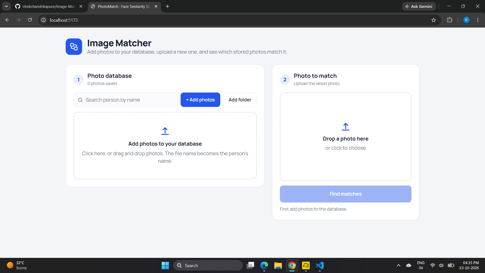
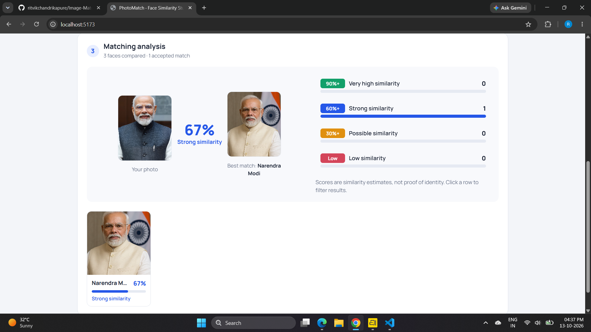

# Image Matcher — Photo Similarity Analysis

A React and Vite web application for maintaining a photo database and comparing an uploaded photo against saved images. The interface displays matching results, similarity percentages, and a matching-analysis summary.

## Screenshots

### Photo database and upload screen


### Saved photos in the database


### Search saved photos by name


### Upload and compare a photo


### Matching analysis results


## Features

- Add photos to the database.
- Import photos from a folder.
- Use image filenames as person labels, as described in the interface.
- Search stored photos by name.
- Upload a photo to compare with the saved database.
- Display matching results and similarity percentages.
- Show the best matching database entry and an analysis summary.
- View similarity groups such as strong, possible, and low similarity.
- Clear the saved photo list from the interface.

## Tech Stack

- React
- Vite
- JavaScript / JSX
- CSS

## Getting Started

### Prerequisites

- Node.js and npm installed.

### Install dependencies

Open a terminal in the project folder and run:

```bash
npm install
```

### Start the development server

```bash
npm run dev
```

Open the local URL shown in the terminal (commonly `http://localhost:5173`).

### Create a production build

```bash
npm run build
```

## Project Structure

The exact structure may vary slightly depending on your current project files.

```text
image-matcher/
├── src/
│   ├── images/
│   │   ├── matcher1.png
│   │   ├── matcher2.png
│   │   ├── matcher3.png
│   │   ├── matcher4.png
│   │   └── matcher5.png
│   ├── App.jsx
│   ├── App.css
│   ├── db.js
│   ├── matcher.js
│   └── main.jsx
├── index.html
├── package.json
├── README.md
└── vite.config.js
```

## Notes

- Similarity percentages are estimates from the application's comparison logic; they should not be treated as proof that two photos depict the same person.
- The screenshots show the interface and sample results. The exact matching method, persistence mechanism, and storage location depend on the implementation in the project source code.

---
Built with React and Vite.
